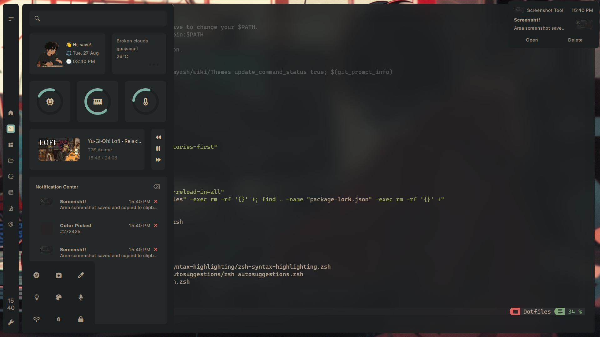
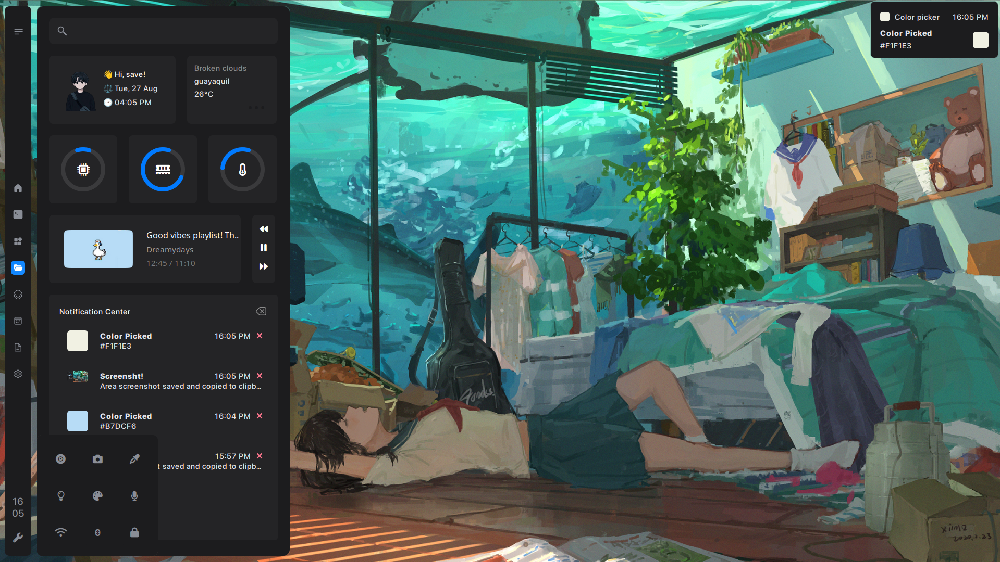
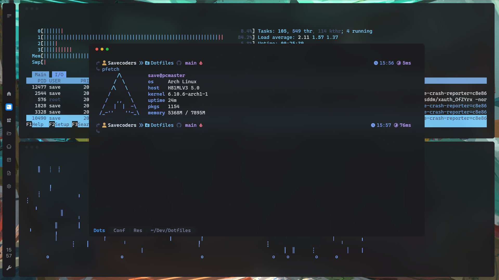
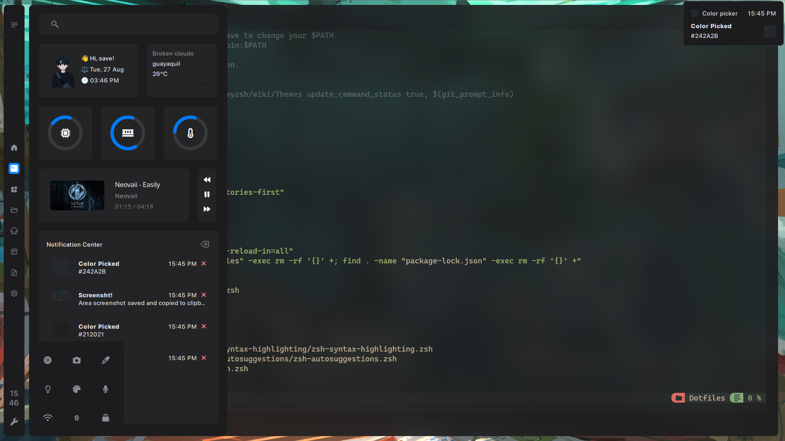
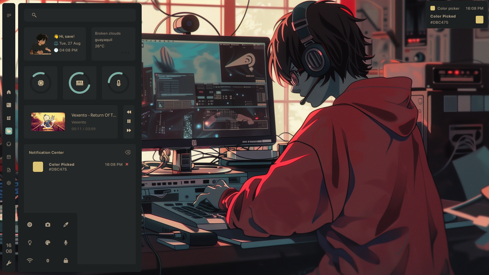
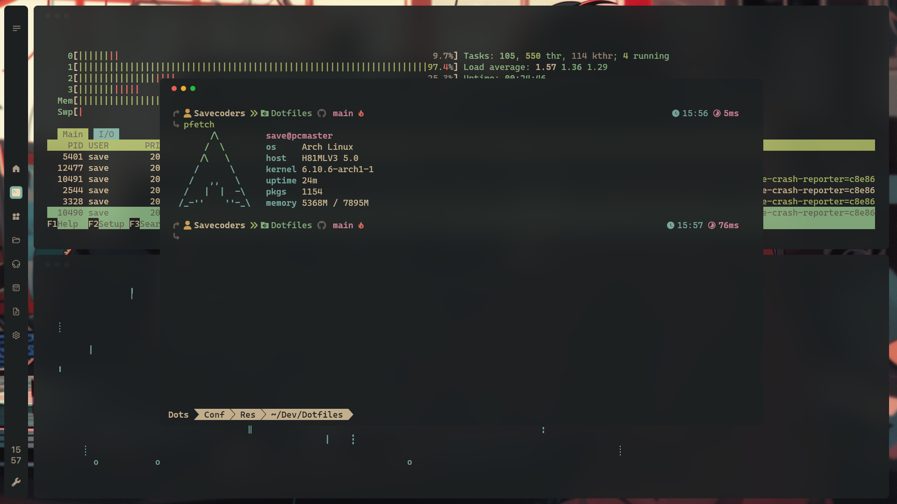
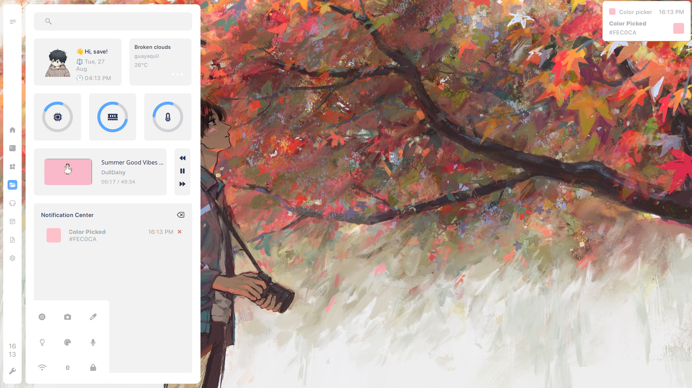
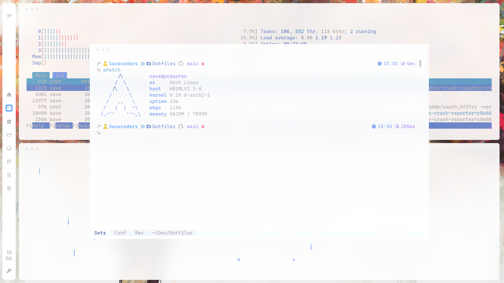
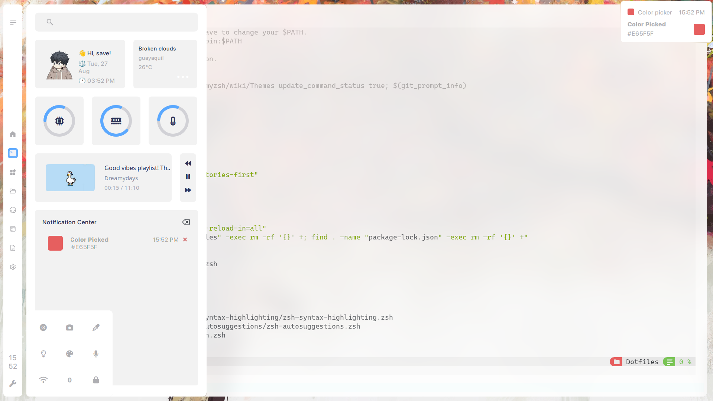

<br>

<!-- BADGES -->
<h1>
  <a href="#">
    
  </a>
  <a href="#">
    
  </a>
</h1>

<h2 align="center" style="font-weight:mediun; padding:30px;">💻 My dotfiles for rice AwesomeWM</h2>

to my dotfiles!
Here are some details about my setup

<!-- INFORMATION -->

## <samp>🧰 **Information** </samp>

Here are some details about my setup:

- **OS:** [Arch Linux](https://archlinux.org/)
- **WM:** [awesome](https://github.com/awesomeWM/awesome) (With Picom) and [Hyprland](https://wiki.hypr.land)
- **Terminal:** [kitty](https://sw.kovidgoyal.net/kitty/)
- **Shell:** [zsh](https://www.zsh.org/)
- **Application Launcher:** [rofi](https://github.com/davatorium/rofi)
- **Editor:** [neovim](https://github.com/neovim/neovim) | [vscode](https://github.com/microsoft/vscode) | [zed](https://zed.dev/)
- **System Font:** [SF Pro Display](https://github.com/sahibjotsagguSan-Francisco-Pro-Fonts)

<!-- Install dependencies-->

## <samp>🎢 **installation** </samp>

<b><h3>🌀 Clone this repository</h3></b>

```sh
git clone --recurse-submodules https://github.com/Savecoders/dotfiles.git
cd dotfiles && git submodule update --remote --merge
```

<b><h3>📥 Use the script</h3></b>

```sh
chmod +x scripts/install.sh && ./scripts/install.sh
```

<b><h3>📦 **NixOS** </h3></b>

The repository ships a flake that reproduces the desktop declaratively on NixOS:

```sh
# Personal convenience outputs (owner)
home-manager switch --flake .#$(whoami) --impure

# NixOS system (import nix/modules + home-manager; add hardware-configuration.nix
# and bootloader options in a real host)
sudo nixos-rebuild switch --flake .#desktop --impure

# Dev shell with Nix tooling
nix develop
```

> [!NOTE]
> `nixosConfigurations."desktop"` is a composable base: combine it with a
> `hardware-configuration.nix`, bootloader and filesystem config for a full system.

```nix
{
  inputs.savior.url = "github:Savecoders/dotfiles";
  inputs.home-manager.url = "github:nix-community/home-manager";

  outputs = { self, nixpkgs, home-manager, savior, ... }@inputs: {
    nixosConfigurations.myhost = nixpkgs.lib.nixosSystem {
      system = "x86_64-linux";
      specialArgs = { inherit inputs; };
      modules = [
        home-manager.nixosModules.home-manager
        savior.nixosModules.default
        {
          services.saviorDesktop.enable = true;
          home-manager.users.YOUR_USER = {
            imports = [ savior.homeManagerModules.default ];
            programs.saviorDotfiles.enable = true;
          };
        }
      ];
    };
  };
}
```

> [!TIP]
> All flake inputs are **optional**: the modules fall back to nixpkgs when a pinned
> input (`hyprland`, `vicinae`, `bling`, `layout-machi`, `quickshell`) is absent. With
> the `vicinae` input present, the NixOS module wires the input-server automatically.

> [!WARNING]  
> ⚠ Critical content demanding immediate user attention due to potential risks.

<details close>
    <summary>
        <samp><b>⁉ Error clone submodules?</b></samp>
    </summary>

In this case you need clone the submodules with repositories and move folders

```sh
mkdir dev && cd dev && git clone https://github.com/Savecoders/dotfiles.git
git clone https://github.com/xinhaoyuan/layout-machi.git
git clone https://github.com/BlingCorp/bling.git
git clone https://github.com/Savecoders/simpleTheme-zsh-theme
cp -r layout-machi/* dotfiles/config/awesome/modules/layout-machi/
cp -r bling/* dotfiles/config/awesome/modules/bling/
cp -r simpleTheme-zsh-theme/* dotfiles/assets/zsh/Savior-zsh-theme
```

</details>

> [!IMPORTANT]  
> Do you want to install manually? Please continue with the manual installation.

<details close>
    <summary>
        <samp><b>Installation Manual Dotfiles</b></samp>
    </summary>

<b><h3>Install Dependencies</h3></b>

```sh
paru -Sy awesome-git picom-git kitty rofi  acpi acpid acpi_call upower \
jq inotify-tools xdotool xclip gpick ffmpeg blueman zsh-autosuggestions \
pamixer brightnessctl scrot redshift rainfall zsh-syntax-highlighting \
feh mpv mpd mpc mpdris2 ncmpcpp playerctl  tunar zsh --needed
```

<b><h3>Enable Services</h3></b>

```sh
systemctl --user enable mpd.service
systemctl --user start mpd.service
```

<b><h3>Clone this repository</h3></b>

```sh
git clone https://github.com/Savecoders/dotfiles.git
cd dotfiles
```

<b><h3> Use config</h3></b>

```sh
cp -r config/* ~/.config/
cp -r assets/fonts/* ~/.local/share/fonts/
cp -r assets/zsh/.zshrc ~
```

<b><h3> Use others rxfetch</h3></b>

```sh
cd neofetch && chmod +x singfetch
sudo cp -r singfetch /usr/bin/
```

<b><h3> Install ohmyzsh</h3></b>

```sh
sh -c "$(curl -fsSL https://raw.githubusercontent.com/ohmyzsh/ohmyzsh/master/tools/install.sh)"
```

</details>

### 🔵 AwesomeWM

<!-- Dark theme -->

#### Dark Theme Mode

<div align="center">
   <a href="#--------">
      
   </a>
</div>

<div align="center">
   <a href="#--------">
      
   </a>
</div>

<div align="center">
   <a href="#--------">
      
   </a>
</div>

#### Grubox Theme Mode

<!-- gruvbox theme -->
<div align="center">
   <a href="#--------">
      
   </a>
</div>

<div align="center">
   <a href="#--------">
      
   </a>
</div>

<div align="center">
   <a href="#--------">
      
   </a>
</div>

#### Light Theme Mode

<!-- light theme -->
<div align="center">
   <a href="#--------">
      
   </a>
</div>

<div align="center">
   <a href="#--------">
      
   </a>
</div>

<div align="center">
   <a href="#--------">
      
   </a>
</div>

## Special Thanks

The dotfiles is based in
and the other parts of code is the others devs :)

- [Rayhan's](https://github.com/rxyhn) [Dotfiles](https://github.com/rxyhn/AwesomeWM-Dotfiles)
- [ChocolateBread799](https://github.com/ChocolateBread799) [Dotfiles](https://github.com/ChocolateBread799/dotfiles)

<!-- information about -->
<details close>
    <summary>
        <samp><b>Quetions</b></samp>
    </summary>

<br>

- **Fonts and icons**
  - as for fonts, the setup uses 4 fonts in total
    - _[SF Pro Display](https://github.com/sahibjotsagguSan-Francisco-Pro-Fonts)_ - my main ui font
    - _[Font Awesome 6 Free](https://fontawesome.com/download)_ - for icons the weather
    - _[JetBrainsMono NF](https://www.jetbrains.com/es-es/lp/mono/)_ - icons of signals
    - _[Cascadia Code](https://github.com/microsoft/cascadia-code)_ - Editor/terminal
  - in the tag config, using images for icons, the images They're in `awesome/icons/tag/`

<br>

- **custom theme?**
  - for dark, edit `theme/dark/dark.lua`
  - for light, edit `theme/light/light.lua`
  - agg display theme selection `theme/selection_theme.lua`

<br>

- **wallpapers and profile**
  - by default wallpapers are found by theme - example: `theme.wallpaper = gfs.get_configuration_dir() .. "wallpapers/hands.jpg"` - in wallpapers folder add new wallpapers `awesome/wallpapers` - replace existing wallpapers with new ones in: `"wallpapers/new_walpapers.jpg"`
    <br>

</details>

## Display arrangement transaction API

Settings → Desktop & Displays includes **Display Arrangement** immediately above
**Connected Displays**. Select or drag a proportional monitor card to edit its local
draft, or enter signed logical X/Y coordinates (−100000 through 100000). The editor and
Connected Displays use the same monitor card component. Dragging snaps to nearby edges
and projects an overlapping target to the nearest valid position; releasing a display
over another swaps their positions when the resulting layout is valid. Coordinate edits
that would overlap another display are rejected and keep the last valid value. The draft
never remains overlapping. The preview scale is fixed from the connected
layout, so moving a display does not resize the group; draft bounds stay centered, and
the canvas grows for vertical arrangements. Touching edges are allowed. Selecting a
Connected Displays card also selects it in the editor; selection inside the editor never
changes the shell's target screen. **Reset Draft** discards local edits; **Refresh**
obtains a new validated snapshot without discarding the draft when observed geometry is
identical. Actual topology, position, scale, rotation, refresh-rate, or display-identity
changes invalidate the snapshot and reset the draft, requiring Refresh before Apply.
They also invalidate any held drag: further motion and release cannot overwrite the
reset or clear its warning. Release and press again to start a fresh drag.

**Apply** explicitly starts an asynchronous preview through the existing controller.
After readback, **Keep** saves it and **Revert** restores it; the countdown shows the
controller's rollback deadline. Busy operations disable editing. Monitor rectangles
remain visible from Hyprland even when controller verification fails, but Apply stays
disabled and the error explains how to retry. The Hyprland bridge must be installed and
loaded before applying; synchronizing Quickshell alone does not deploy that bridge.
A live one-pixel Apply and Revert succeeded on Hyprland 0.56.2; Keep and persistence
across restart remain unverified.

Development checks used isolated QML doubles and mocked compositors; those tests are not
included in this repository. They do not verify physical pointer feel, production styling,
or the complete real compositor transaction lifecycle.
Read-only Hyprland 0.56.2 probes verified that `eval` returns `ok`, while `repl` returns
the Lua string and propagates Lua errors with exit code 7. The adapter therefore uses
`repl` for identity and acknowledgement and preserves command errors. Unknown responses
fail closed rather than reconstructing monitor rules.

One real-compositor probe was attempted inside Bubblewrap with no host DRM/KMS devices,
a private config/runtime directory, and explicit instance targeting. It could not initialize
the headless backend (`CBackend::create() failed!`) and also reported an overlong IPC path.
No compositor transaction was reached in that isolated probe. The separate live test
covered only one-pixel Apply and Revert, not Keep or persistence across restart.

### QML interface

`config/quickshell/services/DisplayArrangement.qml` exposes:

- `monitorsInfo`: the existing `Hyprland.monitorsInfo` binding, not another monitor poller.
- `refresh()`: asynchronously obtain `snapshotData`, including validated logical geometry
  (physical size divided by scale, with axes exchanged for odd transforms).
- `apply(snapshot, positions)`: positions are `[{name, x, y}]` in logical pixels. Keep the
  draft local to the editor and pass the unchanged snapshot from `refresh()`.
- `confirm()` / `revert()`: operate on the current confirmation token.
- `busy`, `phase` (`idle`, `confirming`, `recovery`), `error`, `token`, `deadline` (Unix ms),
  and `finished(action, result)` / `failed(action, message)` signals. Methods return
  whether a request was started, not its eventual result. Refresh after a stale-draft error.

The controller rejects overlap, duplicate/unknown outputs, noninteger or out-of-range
coordinates (absolute limit 100000), mirroring, invalid geometry, and stale snapshots.
Negative coordinates and touching edges are supported. Only changed positions are sent.
Each operation is serialized. Every position patch is followed by bounded readback:
50 ms polling, a two-second budget including query time, and three matching observations.
An in-flight IPC call can extend that budget by its three-second timeout. Confirmation
starts only after the final layout is observed, and lasts 15 seconds. Swaps use temporary
collision-free positions outside both layouts, moving only requested outputs. Partial
errors reverse the movement journal, including temporary placements. An inverse failure
stops rollback rather than risking a collision and enters recovery. Hotplug and expiry
also trigger rollback, including rule restoration for disconnected outputs.
Original `auto`, `auto-left`, `auto-right`, `auto-up`, or `auto-down` position strings
are restored, not replaced with coordinates inferred from monitor JSON. Other nonnumeric
position semantics are rejected before applying changes.

`config/quickshell/scripts/display-arrangement.js` is a Node.js CLI and independent
session controller. Run `node <script> --help` for its JSON request interface. It uses a
private Unix socket in `$XDG_RUNTIME_DIR`, keyed by the Hyprland instance signature.
Its watchdog survives the editor and Quickshell exiting; it does not survive the controller
itself, compositor termination, or a machine crash. IPC calls have three-second timeouts;
rollback is sequential and best effort, not an atomic compositor operation. A failed
rollback blocks new changes and reports recovery instructions. Reloading the updated
Hyprland configuration establishes a new epoch, discards any old preview, waits for
configured geometry, and replays only the previously confirmed state. No old-generation
rollback is sent into the reloaded configuration, and replay never saves a preview.
Do not run competing monitor-management tools, plugins, or multiple sessions sharing
this state file. Startup uses a kernel `flock` on an owned runtime lock file; only its
holder may recover a socket proven stale by connection refusal and unchanged inode.
Competing starts retain the winner's socket. Live sockets, lock files and saved data are
not deleted during recovery. If the controller itself crashed during a preview, reload
Hyprland first: the independent watchdog cannot survive its own process terminating.

### Rule safety and deployment

`config/hypr/config/display-arrangement.lua` must be required **before all monitor
rules**, as in `config/hypr/hyprland.lua`. It merges and tracks each complete rule table
and its exact selector and position semantics. Partial `hl.monitor` updates from the
existing display settings merge into the stored rule instead of replacing it. A move
copies the stored rule and changes only `position`; no mode, scale, transform, VRR, color,
ICC, or reserved field is reconstructed from monitor JSON. The existing
`custom/autostart.lua` rules, including the eDP-1 ICC profile, are unchanged. Any
description/fallback/wildcard rule, missing explicit position, replaced tracking hook,
plugin, unknown output, or unverified compositor version fails closed with an actionable
error. Hyprland **0.56.2** and **0.57.0** are admitted through the same structural guards;
0.57.0 runtime rule-manager behavior remains unverified until a real compositor probe is
possible. Rules must be declared through the tracked `hl.monitor`, not cached pre-hook
functions or native plugins.

Confirmed layouts alone are atomically renamed into
`$XDG_STATE_HOME/savior/display-arrangement.json` (default
`~/.local/state/savior/display-arrangement.json`, file mode 0600). A file fsync precedes
rename; directory fsync is best effort after the commit point. Invalid existing state
and unknown schema versions are not overwritten: back them up explicitly before
replacement. Replay checks the complete connected topology, dimensions, scale, rotation,
and display identity; a different topology requires confirming a new arrangement.
Replay never rewrites saved state. Start/reload hooks replay through the same controller.

Arch's `scripts/needed.list` includes `nodejs` and `util-linux` (for `flock`); the existing
installer consumes that manifest and copies the script and Lua module. Home Manager adds
Node.js and util-linux with Hyprland and deploys the Quickshell scripts directory.
Neither path writes arrangement state into `~/.config/hypr`, so store symlinks work.
Home Manager's existing writable-directory **preserve** seed is unchanged: an already
seeded Hyprland directory will **not** receive the new module or entrypoint automatically.
Back up and manually merge `config/display-arrangement.lua` and the first
`require("config.display-arrangement")` into that user's configuration, before any
monitor declarations. Do not replace the user's directory or custom monitor rules.
The module does not migrate unknown monitor selectors or old arrangement formats.

## Star History

[](https://www.star-history.com/?repos=Savecoders%2Fdotfiles&type=date&legend=bottom-right)
